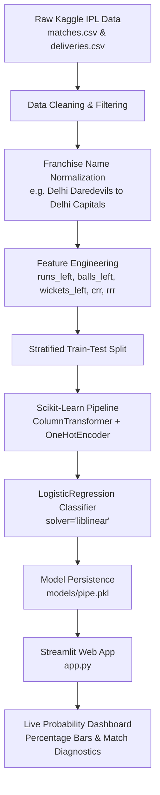

# 🏏 IPL Win Probability Predictor
🚀 **Live Demo: [Click Here to Try the App](https://ipl-win-predictor911.streamlit.app/)**


[](https://www.python.org/)
[](https://streamlit.io/)
[](https://scikit-learn.org/)
[]()
[](LICENSE)

An end-to-end Machine Learning web application designed to forecast the **live ball-by-ball win probability** of second-innings run chases in the Indian Premier League (IPL). Built for college NTCC (Non-Teaching Credit Course) evaluation, academic projects, and developer portfolios.

---

## 📌 Table of Contents
1. [Project Overview](#-project-overview)
2. [Why Machine Learning in Sports Analytics?](#-why-machine-learning-in-sports-analytics)
3. [Architecture & Workflow](#-architecture--workflow)
4. [Mathematical Formulation](#-mathematical-formulation)
5. [Key Features](#-key-features)
6. [Repository Structure](#-repository-structure)
7. [Tech Stack](#-tech-stack)
8. [Step-by-Step Installation Guide](#-step-by-step-installation-guide)
9. [How to Run](#-how-to-run)
10. [Dataset Schema & Setup](#-dataset-schema--setup)
11. [NTCC Viva & Interview Q&A](#-ntcc-viva--interview-qa)
12. [License](#-license)

---

## 🚀 Project Overview

In limited-overs T20 cricket, predicting the match outcome in the second innings is non-linear and high-stakes. A single wicket or a sequence of boundary hits dynamically swings the win probability. 

This project processes historical ball-by-ball IPL match data (2008–Present), cleans inconsistent franchise records (e.g., mapping *Delhi Daredevils* to *Delhi Capitals*), extracts match context metrics, and trains a calibrated **Scikit-Learn Pipeline** using **Logistic Regression with One-Hot Encoding**. The model is served through an interactive, responsive **Streamlit** dashboard.

---

## 💡 Why Machine Learning in Sports Analytics?

- **Why Logistic Regression over Tree-Based Models?**
  - Decision Trees and standard Random Forests generate piece-wise constant (step-like) probabilities that can jump erratically (e.g., jumping from 40% straight to 70% on one ball).
  - Logistic Regression models the log-odds linearly, producing smooth, continuous, and well-calibrated probabilities between 0% and 100% via the Sigmoid curve.
- **Strict Featurization Order:**
  - In compliance with ML best practices, all transformations (`OneHotEncoder`) are bundled within an end-to-end `Pipeline` object, preventing train-test data leakage.

---

## 🏗 Architecture & Workflow



---

## 📐 Mathematical Formulation

### 1. Second Innings Target
$$\text{Target Score} = \text{Runs scored in 1st Innings} + 1$$

### 2. Runs & Balls Remaining
$$\text{Runs Left} = \text{Target Score} - \text{Current Score}$$
$$\text{Balls Bowled} = (\lfloor\text{Overs}\rfloor \times 6) + \text{Remaining Balls}$$
$$\text{Balls Left} = 120 - \text{Balls Bowled}$$

> **Cricket Overs Decimal Precision:**
> In cricket, `10.2` represents 10 overs and 2 balls ($10 \times 6 + 2 = 62$ balls), **not** $10.2$ overs ($61.2$ balls). Our application strictly parses fractional overs using true cricket ball conversion.

### 3. Run Rates
$$\text{Current Run Rate (CRR)} = \frac{\text{Current Score} \times 6}{\text{Balls Bowled}}$$
$$\text{Required Run Rate (RRR)} = \frac{\text{Runs Left} \times 6}{\text{Balls Left}}$$

### 4. Logistic Probability Sigmoid Function
$$P(\text{Win} \mid X) = \frac{1}{1 + e^{-(\beta_0 + \sum \beta_i X_i)}}$$

---

## ✨ Key Features

- **Dynamic Probability Engine:** Live calculation of winning odds for both the chasing and defending teams.
- **Real-Time Match KPI Cards:** Immediate feedback on Runs Needed, Balls Left, Wickets in Hand, CRR, and RRR.
- **Preset Chase Scenarios:** Instant testing of famous game states (Nail-Biter, Powerplay Rampage, Top-Order Collapse).
- **Safe Boundary Validation:** Catches illegal match states (e.g., target already scored, all out, over-limit inputs).
- **Graceful Dataset Fallback:** `train_model.py` automatically generates a synthetic sample dataset if raw Kaggle CSVs are not present, ensuring immediate runnable demonstration.

---

## 📁 Repository Structure

```text
ipl_win/
│
├── data/
│   ├── README.md               # Dataset download instructions and links
│   ├── matches.csv             # Kaggle match-level records (Place here)
│   └── deliveries.csv          # Kaggle ball-by-ball delivery records (Place here)
│
├── models/
│   ├── pipe.pkl                # Serialized Scikit-Learn trained Pipeline
│   └── metadata.json           # Model configuration, accuracy, and teams list
│
├── notebooks/
│   └── ipl_win_predictor.ipynb # Interactive Jupyter Notebook with EDA & visualizations
│
├── app.py                      # Production Streamlit Web Application
├── train_model.py              # Automated data preprocessing and model training script
├── requirements.txt            # Project dependencies
└── README.md                   # Complete project documentation
```

---

## 🛠 Tech Stack

- **Programming Language:** Python 3.9+
- **Machine Learning & Pipeline:** Scikit-Learn
- **Data Manipulation:** Pandas, NumPy
- **Web Dashboard:** Streamlit
- **Visuals & EDA:** Matplotlib, Seaborn
- **Model Serialization:** Pickle

---

## 💻 Step-by-Step Installation Guide

### Prerequisites
Make sure Python 3.9 or newer is installed on your system.

### 1. Clone or Open the Repository
```bash
git clone https://github.com/yuvvhere911-dotcom/ipl_win_predictor.git
cd ipl_win_predictor
```

### 2. Create a Virtual Environment
- **On Windows (PowerShell):**
  ```powershell
  python -m venv .venv
  .\.venv\Scripts\Activate.ps1
  ```
- **On macOS / Linux:**
  ```bash
  python3 -m venv .venv
  source .venv/bin/activate
  ```

### 3. Install Required Dependencies
```bash
pip install -r requirements.txt
```

---

## 🏃 How to Run

### Step 1: Train the Machine Learning Model
Run the automated training script:
```bash
python train_model.py
```
*What happens:*
- The script checks `data/matches.csv` and `data/deliveries.csv`.
- If found, it filters defunct teams, engineers features, and fits the pipeline.
- If not yet downloaded, it creates a sample dataset, trains the pipeline, and writes `models/pipe.pkl`.

### Step 2: Launch the Streamlit Web Application
```bash
streamlit run app.py
```
The application will launch automatically in your default browser at `http://localhost:8501`.

---

## 📊 Dataset Schema & Setup

For training on the full historical IPL records (2008–2024):
1. Download the dataset from Kaggle: [IPL Complete Dataset (2008-2020)](https://www.kaggle.com/datasets/patrickb1912/ipl-complete-dataset-20082020) or [IPL Dataset (2008-2023)](https://www.kaggle.com/datasets/littleraj30/ipl-dataset).
2. Unzip and place the files directly into the `data/` directory:
   - `data/matches.csv`
   - `data/deliveries.csv`
3. Execute `python train_model.py` to retrain the pipeline on the full dataset.

---

## 🎓 NTCC Viva & Interview Q&A

**Q1: Why did you choose Logistic Regression instead of Random Forest or XGBoost?**  
> *Answer:* In win probability prediction, the primary metric is calibrated probability (`predict_proba`), not just discrete binary classification. Random Forest and XGBoost output step-wise boundary decisions, whereas Logistic Regression directly models log-odds using the continuous sigmoid function, resulting in smoother and more realistic live probabilities.

**Q2: How do you handle renamed and defunct IPL franchises?**  
> *Answer:* Historical franchises like *Delhi Daredevils* were renamed to *Delhi Capitals*, and *Deccan Chargers* evolved into *Sunrisers Hyderabad*. We apply a dictionary mapping to standardize historical data with active franchises and filter out temporary defunct teams (e.g., *Kochi Tuskers Kerala*, *Pune Warriors*).

**Q3: How is data leakage prevented during preprocessing?**  
> *Answer:* We use a Scikit-Learn `Pipeline` combining `ColumnTransformer` and `OneHotEncoder`. The train-test split is performed *before* fitting the pipeline, ensuring that the test set remains completely unseen during encoding.

**Q4: How do you convert cricket overs to mathematical balls?**  
> *Answer:* Overs are parsed into integer overs and decimal extra balls. For instance, `14.3` overs corresponds to $(14 \times 6) + 3 = 87$ balls bowled, avoiding the common error of treating `.3` as a standard tenth of an over.
---

## 👤 Author
- **GitHub:** [@yuvvhere911-dotcom](https://github.com/yuvvhere911-dotcom)
- **Repository:** [IPL Win Predictor](https://github.com/yuvvhere911-dotcom/ipl_win_predictor)

---

## 📜 License
This project is open-source and licensed under the [MIT License](LICENSE).
